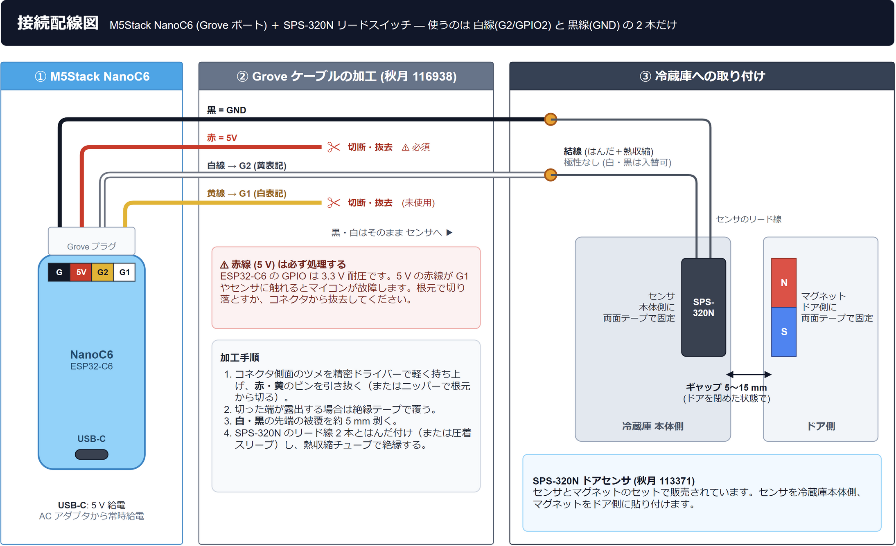

# Fridge Guard (冷蔵庫みまもり) — Rust on ESP-IDF

[](https://github.com/771-8bit/fridge_guard/actions/workflows/ci.yml)

冷蔵庫ドアの開閉状況を検知し、一人暮らしや離れて暮らす家族の生活活動を毎晩1回LINEで報告する、 **月額0円・常時稼働サーバ不要** のオープンソース見守りシステムです。

ハードウェア基盤には **M5Stack NanoC6 (ESP32-C6 / 4 MB Flash)**、ファームウェア実装には安全でモダンな **Rust (Rust-on-ESP-IDF)** を採用しています。

---

> [!IMPORTANT]
> ### 本システムが意味する「見守り」について
> 本機器は医療機器でも、人の生命・身体の安全を直接確認・保証する装置でもありません。
> 冷蔵庫ドアの開閉という **生活活動の代理指標（プロキシ）** を1日1回報告するものです。
> 「冷蔵庫が開いた ＝ 本人が無事・安全」と機械的に断定することはできません。異常通知やレポート未着の際は、必ず電話や直接訪問等により状況をご確認ください。

---

## 1. 必要なもの (BOM)

すべて通販で購入可能です。

| 部品名 | 型番 / 仕様 | 購入先リンク | 価格目安 | 備考 |
|---|---|---|:---:|---|
| **マイコンボード** | M5Stack NanoC6 (SKU: C125) | [秋月電子 (129456)](https://akizukidenshi.com/catalog/g/g129456/) | 約1,480円 | ESP32-C6FH4, 4 MB Flash, Grove端子, ボタン(GPIO9)搭載 |
| **ドア開閉センサ** | SPS-320N (リードスイッチ) | [秋月電子 (113371)](https://akizukidenshi.com/catalog/g/g113371/) | 約550円 | センサとマグネットのセット |
| **Grove 4P ケーブル** | コネクター付コード 4P (Grove用) | [秋月電子 (116938)](https://akizukidenshi.com/catalog/g/g116938/) | 約110円 | NanoC6にはケーブルが付属しないため必須 |
| **USB電源 & ケーブル** | 5 V USB Type-C 出力 | *(汎用品をご利用ください)* | - | PSEマーク付きの安全なACアダプタを推奨 |
| **取付テープ** | コマンドタブ / 強力両面テープ | *(汎用品をご利用ください)* | - | 冷蔵庫本体およびドアへのセンサ固定用 |

---

## 2. ケーブルの加工と配線

### 接続配線図



| Grove 線 (ケーブル) | NanoC6 端子 (基板の表記) | 処理 |
|---|---|---|
| 白 | G2 (GPIO2) ※基板上では黄色表記 | SPS-320N のリード線へ結線 |
| 黒 | G (GND) | SPS-320N のもう一方のリード線へ結線 |
| 赤 | 5V | **切断またはピン抜去 (必須)** |
| 黄 | G1 (GPIO1) ※基板上では白色表記 | 切断またはピン抜去 (未使用) |

> [!WARNING]
> NanoC6 の端子表記は左から G (黒)、5V (赤)、G2 (黄)、G1 (白) ですが、秋月 116938 のケーブルは コネクタ側から 黒・赤・白・黄 の順 (データシート DG01032-0064-03) で、**黄と白の線色が基板の表記色と一致しません**。表記色ではなく、上の表のとおり「白線 = G2」「黄線 = G1」として扱ってください。

<sub>図の原本は [docs/images/wiring_diagram.drawio](docs/images/wiring_diagram.drawio) (draw.io で編集可)。</sub>

### 加工・結線の手順
1. **不要配線の除去**:
   - Groveケーブル（秋月 116938）の **赤線（5 V）** と **黄線（GPIO1）** は使用しません。
   - コネクタのツメを精密ドライバー等で軽く持ち上げてピンを引き抜くか、根元からニッパーで切り落として除去してください。
   > [!CAUTION]
   > ESP32-C6のGPIOは3.3 V耐圧です。5 Vの赤線がセンサやGPIOに触れるとマイコンが故障するため、必ず切り落とすかピンを引き抜いて除去してください。
2. **センサとの結線**:
   - 残った **白線（GPIO2）** と **黒線（GND）** の被覆を剥き、SPS-320Nの2本のリード線とはんだ付けや圧着スリーブなどでそれぞれ接続し、絶縁テープや熱収縮チューブで保護します。
   - リードスイッチには極性（プラス・マイナスの向き）はありません。どちらを白・黒に繋いでも正常に動作します。

---

## 3. 完全セットアップ手順 (ゼロから導入完了まで)

このセクションの手順を上から順に実行するだけで、完全に動作する状態までセットアップできます。

### 前提ツールの準備
お使いのPC（Windows / macOS / Linux）に以下を準備してください：
1. **Rust**: [rustup.rs](https://rustup.rs/) からインストール（`rust-toolchain.toml` で固定した nightly が自動で使われます）
2. **uv (Pythonパッケージマネージャ)**: [docs.astral.sh/uv](https://docs.astral.sh/uv/) からインストール
   ```bash
   # Windows (PowerShell)
   powershell -ExecutionPolicy ByPass -c "irm https://astral.sh/uv/install.ps1 | iex"
   # macOS / Linux
   curl -LsSf https://astral.sh/uv/install.sh | sh
   ```
3. **書き込みツール (`espflash`)**:
   ```bash
   cargo install ldproxy
   cargo install espflash --locked
   ```
4. **Python 3.12 と Git**: 初回ビルド時に ESP-IDF のダウンロードとセットアップに使われます（Windows での追加手順は [docs/BUILD.md](docs/BUILD.md) を参照してください）。

---

### ステップ 1: LINE公式アカウントの開設とトークン取得

月額0円でLINE通知を送信するためのアカウントを開設します。

1. [LINE Developers Console](https://developers.line.biz/) にLINEアカウントでログインします。
2. 「プロバイダー」を作成（例: `家族見守り`）。
3. 「新規チャネル作成」をクリックし、**「Messaging API」** を選択します。
   - チャネル名: `冷蔵庫みまもり`
   - チャネル説明: `冷蔵庫の生活活動レポート`
   - 大業種/小業種: `住まい / その他`
4. 作成後、チャネル設定画面の **「Messaging API」** タブを開きます。
5. 一番下にある **「チャネルアクセストークン（長期）」** の「発行」ボタンを押し、表示されたトークンをメモ帳などに控えます。
6. チャネル設定の **「チャネル基本設定」**（Basic settings）タブを開き、**「チャネルシークレット」**（Channel Secret）も控えておきます。

---

### ステップ 2: 通知先となる家族の LINE User ID を取得する

家族のLINEアプリ宛てに直接メッセージを届けるための固有ID（`U`から始まる33文字）を取得します。

1. LINE Developersの「Messaging API」タブにある **QRコード** を、通知を受け取りたい家族のスマホで読み取り、友だち追加します。
2. PCのターミナルで、付属の取得ツールを実行します：
   ```bash
   uv run tools/line_user_capture.py
   ```
   *(プロンプトが出たら、ステップ1で控えた「Channel Secret」を貼り付けます)*
3. 別のターミナルを開き、一時的な中継トンネル（Cloudflare Tunnel）を起動します：
   ```bash
   # cloudflaredが未インストールの場合はダウンロードするか、各OSのパッケージマネージャで導入
   cloudflared tunnel --url http://127.0.0.1:8080
   ```
4. 表示されたHTTPSアドレスの末尾に `/callback` を付けたURL（例: `https://xxxx.trycloudflare.com/callback`）を、LINE Developers Consoleの **「Webhook URL」** に貼り付けて「更新」を押し、「Webhookの利用」を **有効 (ON)** にします。
5. 家族のスマホから、追加した公式アカウントへ何でもよいのでメッセージ（例: `テスト`）を1通送信します。
6. PCのターミナルに自動的に家族の **`userId` (`U...`)** が表示され、ローカルファイル `.line_user_id` に保存されてツールが終了します。
7. **後片付け**: LINE Developers Consoleの「Webhookの利用」を **無効 (OFF)** に戻し、cloudflaredのターミナルを終了します。

---

### ステップ 3: ファームウェアを M5Stack NanoC6 に書き込む

1. M5Stack NanoC6 をお持ちのUSB Type-Cケーブル（データ通信対応）でPCに接続します。
2. `firmware` ディレクトリで以下を実行してビルド＆書き込みを行います（初回は ESP-IDF のダウンロードとビルドに 10〜30 分ほどかかります）：
   ```bash
   cd firmware
   cargo run --release
   ```
   *(ポートの選択肢が出たら、接続されたCOMポート / ttyACMを選択してください)*
3. 書き込みが完了すると、シリアルモニタに起動ログが表示されます。確認できたら `Ctrl + C` でモニタを終了します。

---

### ステップ 4: Wi-Fi情報とLINEトークンを本体に設定する

PCとNanoC6をUSB接続したまま、プロビジョニングツールを実行します：

```bash
uv run tools/provision.py
```

画面の案内に従って入力します（初回は Wi-Fi と LINE の項目が必須です。それ以外の項目は Enter キーを押すと現在の設定値またはデフォルト値が維持されます）：
- **Wi-Fi SSID**: 設置場所の2.4 GHz Wi-Fiネットワーク名
- **Wi-Fi Password**: Wi-Fiのパスワード（8〜63文字。入力文字は画面に表示されず安全に入力できます）
- **LINE Channel Access Token**: ステップ1で発行した長期トークン
- **Destination LINE User ID**: ステップ2で取得した家族のUser ID (`U...`)
- **Daily Report Time**: 毎晩の通知時刻（デフォルト: `20:00`）
- **Inactivity / Door-open alert**: 活動未検知アラート（デフォルト24時間）とドア開放アラート（デフォルト30分）。`0` を指定すると無効化可能
- **Monthly LINE message cap**: 月間送信上限（デフォルト: 120通）
- **Button Short/Long Press**: ボタン操作の割り当て（デフォルトのままでよければそのままEnter。短押し: `line_test` / 長押し: `ota_check`）

入力内容の確認が表示されたら `yes` と入力してEnterを押します。設定がNanoC6内部の不揮発性メモリ（NVS）に保存され、本体が自動で再起動して新しい設定で動き始めます。

---

### ステップ 5: 冷蔵庫への取り付けと動作確認

1. **冷蔵庫への貼り付け**:
   - **SPS-320N（センサ本体）**: 冷蔵庫の固定側フレーム外側に両面テープで貼り付けます。
   - **付属マグネット**: 冷蔵庫の開閉ドア外側に貼り付けます。
   - **位置関係**: ドアを閉めたとき、センサとマグネットの三角マークが向き合い、 **隙間が5〜15 mm程度** になるように調整してください。
   - **NanoC6本体**: 冷蔵庫の側面や天面など、Wi-Fi電波が届きやすくボタンが押せる位置に貼り付けます（※金属板にアンテナを密着させず少し離すと通信が安定します）。
2. **電源投入**:
   - 5 V USB Type-C電源アダプタをコンセントに差し込み、NanoC6に接続します。
3. **動作テスト（テスト送信）**:
   - 電源投入から1分ほど待ち（Wi-Fi接続と時刻合わせのため）、NanoC6本体の物理ボタン（GPIO9）を **カチッと短押し（1.5秒未満）** します。
   - 家族のLINEに以下のような **【テスト通知】** が届けば、すべての設置作業は完了です！（※本体LEDによる動作表示はありません。届かない場合は `uv run tools/provision.py --status` で状態を確認してください）

```text
【テスト通知】Fridge Guard 機器テスト送信

本メッセージは本体ボタン（または管理操作）による試験送信です。
・現在のドア状態: 閉
・本日利用回数: 0 回
・Wi-Fi接続: 良好
・ファームウェア: v0.1.0

※本通知は冷蔵庫ドアの開閉状況を示す生活活動の参考情報であり、利用者の安全を直接確認・保証するものではありません。
```

---

## 4. 日常の動作と通知一覧

### ① 毎日の定期レポート (毎晩 20:00 JST)
その日の開閉回数と最終利用時刻が自動送信されます。
```text
【冷蔵庫活動レポート】2026-10-27
・本日利用回数: 9 回
・最終利用時刻: 19:24 (36分前)
・現在のドア状態: 閉
・ファームウェア: v0.1.0
```
*(※万一、通信障害等で送信できなかった場合は復旧時に自動で再送され、予定時刻から10分以上遅れたときは先頭に `【遅延送信】` と明記されます。1日以上届かなかった場合は、最新日のレポートのみが送信されます)*

> [!NOTE]
> **免責事項の表記方針について**:
> 毎日の定期レポートはスマートフォンのプッシュ通知やロック画面の要約プレビューで「本日利用回数」や「最終利用時刻」などの重要情報が埋もれないよう、本文に免責文を含めず簡潔に整形しています。一方、テスト通知や後述の各種警戒・復旧通知には万全を期して末尾に法的免責文が明記されます。

### ② 異常時の警戒通知
- **24時間活動未検知**:
  前回の開閉から24時間一度もドアが開かなかった場合に1回だけ送信されます（時間は設定で変更・無効化できます。最終利用時刻は再起動や停電をまたいで保持されます）。
  ```text
  【活動未検知】冷蔵庫の開閉を24時間検知していません。

  機器は正常に動作していますが、前回の開閉から設定時間を経過しました。
  必要に応じて電話や訪問などで状況を確認してください。
  (ファームウェア: v0.1.0)

  ※本通知は冷蔵庫ドアの開閉状況を示す生活活動の参考情報であり、利用者の安全を直接確認・保証するものではありません。
  ```
  *(※その後、再び冷蔵庫が開くと以下の `【活動再開】` 通知が1回届き、自動で通常監視に戻ります)*
  ```text
  【活動再開】冷蔵庫の利用を検知しました。

  活動が確認されたため、通常の監視状態へ復帰しました。
  (ファームウェア: v0.1.0)

  ※本通知は冷蔵庫ドアの開閉状況を示す生活活動の参考情報であり、利用者の安全を直接確認・保証するものではありません。
  ```
- **30分以上ドア開放**:
  半開きやセンサ外れ等で30分以上ドアが開いたままの場合に送信されます（起動時からセンサが外れている場合も含みます）。
  ```text
  【ドア開放警告】冷蔵庫のドアが30分以上開いた状態（またはセンサ配線外れ）です。

  ドアが半開きになっているか、センサ配線が外れている可能性があります。確認してください。
  (ファームウェア: v0.1.0)

  ※本通知は冷蔵庫ドアの開閉状況を示す生活活動の参考情報であり、利用者の安全を直接確認・保証するものではありません。
  ```

---

## 5. 本体ボタン操作

NanoC6本体の物理ボタン（GPIO9）を使って、その場で状態確認や手動更新ができます。割り当ては設定ツールで `line_test` / `status_now` / `ota_check` / `none` から変更できます。

| 操作 | 動作（デフォルト） | 説明 |
|---|---|---|
| **短押し (1.5秒未満)** | **LINE試験送信** | LINEへテスト通知を送信（開閉カウントや日次レポート状態には影響しません。月間の送信回数としてカウントされます） |
| **長押し (約3秒)** | **手動OTA確認** | マニフェストを確認し、新ファームウェアがあれば自動更新して再起動 |

本体のLEDによる動作表示はありません。結果は届いたLINEメッセージ、またはUSB接続して `uv run tools/provision.py --status` で確認します。

---

## 6. よくある質問 & トラブルシューティング

### Q. 定期通知が届かない日がある
本システムは常時稼働サーバを持たない完全サーバレス設計のため、 **「停電や家庭内ルーター停止などでNanoC6自体が通信不能になった場合、デバイス自身からエラーを送ることはできません」** 。
したがって、 **「予定時刻から30分以上（デフォルト設定では20:30）過ぎてもレポートが届かないこと」自体が確認のサイン** となります。設置場所の電源やWi-Fiルーターをご確認ください。

### Q. 自宅のWi-Fiルーターやパスワードが変わった
PCとNanoC6をUSBケーブルで接続し、設定ツールを実行するだけで更新できます：
```bash
uv run tools/provision.py
```
新しいSSIDとパスワードを入力し、他の項目はEnterで現在の値のまま保存すれば完了です（LINEトークンの再入力、再コンパイルや再書き込みは不要です。本体は自動で再起動します）。

### Q. ドアを開けてもカウントが増えない
- センサ本体とマグネットの隙間が広すぎる可能性があります。ドアを閉めた状態で5〜15 mm以内になっているか確認してください。
- センサの配線が抜けていないか確認してください（※配線が断線するとフェイルセーフにより常時「開」と判定され、30分後にドア開放警告が送信されます）。

---

## 7. セキュリティモデルと脅威への対策

本システムは、家庭用IoT機器としてプライバシー保護と不正アクセス防止を両立するため、以下のセキュリティ設計方針を採用しています。

### ネットワーク経由の脅威に対する保護
ネットワーク経由の攻撃に対しては、攻撃対象領域（アタックサーフェス）を最小限に抑える多層防御を行っています：

1. **インバウンド（受信待受）ポートの完全排除**:
   本機はWeb管理画面、Telnet、SSH、MQTT、mDNSなどの待受サービスを一切起動しません。
   通信はマイコン側から外向き（Outbound）のHTTPSリクエスト（LINEプッシュ通知およびGitHub ReleasesへのOTA確認）のみに限定されており、外部ネットワークや家庭内LANからのスキャン・不正接続経路を構造的に遮断しています。
2. **TLS / HTTPS証明書の厳格な検証**:
   ESP-IDF標準のMozillaルートCA証明書バンドルを利用し、LINE（`api.line.me`）およびGitHub（`github.com`）のサーバ証明書を厳格に検証します。通信の暗号化により、公衆回線や家庭内Wi-Fi上での盗聴・改ざん・なりすましを防止します。
3. **認証情報の局所化と分離**:
   Wi-FiパスワードやLINEトークンは公開リポジトリやビルド成果物には一切埋め込まず、物理USB-Cシリアル接続を通じて本体の保護領域（NVS）にのみ保存されます。
4. **ファームウェア（デバイス側）での送信レート制限**:
   プログラムの不具合やセンサのチャタリング等の機械的トラブルによる意図しない大量送信を防ぐため、ファームウェアが送信するすべてのLINEメッセージに月間120通（デフォルト）の上限枠（LINE無料プランの月間200通以内）を設けています。

このように、外向きHTTPS通信のみに特化し、受信待受を完全になくすことで、ネットワーク経由のリモート攻撃に対して構造上極めて堅牢なアーキテクチャを実現しています。

### 物理的なアクセスに対する保護（オプション）
本機は通常、個人の住宅内に設置されるため物理盗難のリスクは限定的ですが、共有スペースへの設置など「物理的に機器が持ち去られ、フラッシュメモリを直接解析されるリスク」への対策が必要な環境向けに、ESP32-C6のハードウェアセキュリティ機能にも対応しています：

- **Flash Encryption（フラッシュ暗号化）**:
  SPIフラッシュの全領域をAES-128-XTSで暗号化し、チップから直接データを読み出されても認証情報等の平文抽出を防止します。
- **Secure Boot v2（セキュアブート）**:
  公開鍵暗号による署名検証を行い、承認された正規ファームウェア以外が起動しないようハードウェアレベルで制限します。

※これらの機能はESP32-C6のeFuse（不可逆ヒューズ）に書き込みを行うため、設定ミスによる復旧不能（文鎮化）リスクを伴います。物理セキュリティの強化が必要な場合は、基本機能の動作確認が完了した後に [`docs/OPTIONAL_DEVICE_HARDENING.md`](docs/OPTIONAL_DEVICE_HARDENING.md) の手順に従って慎重に適用してください。

---

## 8. 詳細ドキュメント (Documentation)

プロジェクトの設計、開発、運用に関するより詳細なガイドは **[docs/ (ドキュメント一覧)](docs/README.md)** に収録されています：

- **導入・設定**:
  - [結線・設置詳細ガイド (`docs/INSTALLATION.md`)](docs/INSTALLATION.md)
  - [LINE Messaging API・Webhook設定手順 (`docs/LINE_SETUP.md`)](docs/LINE_SETUP.md)
  - [USBシリアル設定ツール解説 (`docs/PROVISIONING.md`)](docs/PROVISIONING.md)
- **開発・ビルド**:
  - [Rust ツールチェイン構築手順 (`docs/RUST_TOOLCHAIN.md`)](docs/RUST_TOOLCHAIN.md)
  - [ファームウェアのビルド・書き込み手順 (`docs/BUILD.md`)](docs/BUILD.md)
  - [受入テスト・検証仕様書 (`docs/VERIFICATION.md`)](docs/VERIFICATION.md)
- **運用・セキュリティ**:
  - [GitHub Releases 連携 OTA 配信ガイド (`docs/OTA_RELEASE.md`)](docs/OTA_RELEASE.md)
  - [セキュリティ運用指針 (`docs/SECURITY_OPERATIONS.md`)](docs/SECURITY_OPERATIONS.md)
  - [Flash暗号化 & セキュアブート手順 (`docs/OPTIONAL_DEVICE_HARDENING.md`)](docs/OPTIONAL_DEVICE_HARDENING.md)
  - [トラブルシューティング詳細 (`docs/TROUBLESHOOTING.md`)](docs/TROUBLESHOOTING.md)
  - [アーキテクチャ設計判断記録 (`docs/implementation_decisions.md`)](docs/implementation_decisions.md)

全体マップおよび詳細は **[docs/README.md](docs/README.md)** をご覧ください。

---

## 9. ライセンス (License)

本プロジェクトは **[MIT License](LICENSE)** の下で公開されています。商用・非商用問わず、どなたでも自由にご利用・改変・再配布いただけます。
