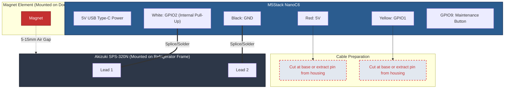

# Hardware Assembly & Installation Guide

This guide details the physical assembly, wiring, and refrigerator mounting of the Fridge Guard monitor.

---

## 1. Bill of Materials (BOM)

| Item | Component | Part / SKU | Purchase Link | Notes |
|---|---|---|---|---|
| 1 | Controller Module | **M5Stack NanoC6** (SKU C125) | [秋月電子 (129456)](https://akizukidenshi.com/catalog/g/g129456/) | ESP32-C6FH4, 4 MB Flash, Grove port, onboard button (GPIO9) |
| 2 | Magnetic Door Sensor | **Akizuki Denshi SPS-320N** | [秋月電子 (113371)](https://akizukidenshi.com/catalog/g/g113371/) | A-contact dry reed switch + magnet element |
| 3 | Grove Sensor Cable | **Connector Cable 4P (for Grove)** | [秋月電子 (116938)](https://akizukidenshi.com/catalog/g/g116938/) | Required (cable is not bundled with NanoC6) |
| 4 | Power Supply | 5 V USB AC Adapter & Cable | *(Generic / Off-the-shelf)* | PSE-certified 5 V / 1 A+ USB Type-C power |
| 5 | Mounting Materials | Double-sided mounting tape | *(Generic)* | Removable adhesive (e.g. 3M Command) for module and reed switch |

---

## 2. Grove Cable Preparation & Wiring

The M5Stack NanoC6 Grove port pinout is:
- **Pin 1 (Black)**: GND
- **Pin 2 (Red)**: 5 V *(NOT USED — REMOVE)*
- **Pin 3 (White)**: GPIO2 *(Door Sensor Input)*
- **Pin 4 (Yellow)**: GPIO1 *(NOT USED — REMOVE)*

> [!NOTE]
> The NanoC6 pad labels are colored G (black), 5V (red), G2 (yellow), G1 (white), but Akizuki 116938 (DG01032-0064-03) is wired Black / Red / White / Yellow from pin 1. The **White wire lands on the pad labeled G2** and the **Yellow wire on the pad labeled G1**: the wire colors do not match the pad label colors. Follow the pin list above.

### Critical Safety Instruction
> [!CAUTION]
> **REMOVE UNUSED RED (5 V) AND YELLOW (GPIO1) WIRES**:
> ESP32-C6 GPIO pins are rated for 3.3 V maximum. Connecting 5 V will permanently damage the microcontroller.
> Before splicing, **extract the Red and Yellow terminal pins from the connector housing, or cut them flush at the connector base** so there is zero risk of accidental contact.

---

## 3. Refrigerator Mounting Instructions

1. **Bench Multimeter Check**:
   - Before mounting, connect a multimeter in continuity mode across the SPS-320N leads.
   - Verify: When magnet is adjacent, circuit is CLOSED (beeps). When magnet is moved away, circuit is OPEN.
2. **Mount Sensor & Magnet**:
   - Affix the SPS-320N switch body to the fixed refrigerator frame.
   - Affix the magnet element to the movable refrigerator door.
   - Ensure the alignment marks face each other and the gap when closed is between 5 mm and 15 mm.
   - Confirm that opening the door separates the magnet by at least 30 mm.
3. **Mount M5Stack NanoC6**:
   - Mount on an exterior side or top surface of the refrigerator using removable adhesive.
   - **Antenna Spacing**: Do not mount the NanoC6 ceramic antenna flush against a large sheet-metal panel. Provide at least 10–20 mm spacing or place it near a plastic trim section to maintain strong Wi-Fi reception.
   - **Accessibility**: Ensure the onboard GPIO9 button remains easily accessible.
4. **Strain Relief**:
   - Use adhesive cable clips to secure both the USB-C cable and the Grove cable so accidental pulls do not stress the module connectors.

---

## 4. Checking Device Operation

The firmware does not drive the NanoC6 onboard LEDs, so there is no on-device status indication. To confirm operation:

- **At the refrigerator**: Short-press the GPIO9 button. The recipient receives a `【テスト通知】` LINE message once the device has Wi-Fi and network time (allow about a minute after power-on).
- **With a laptop**: Connect USB-C and run `uv run tools/provision.py --status` (see [PROVISIONING.md](PROVISIONING.md)) to see Wi-Fi, time sync, door state, today's count, and LINE delivery failures.
